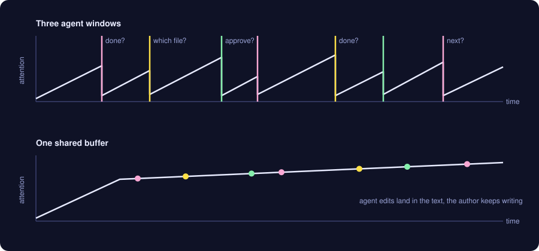
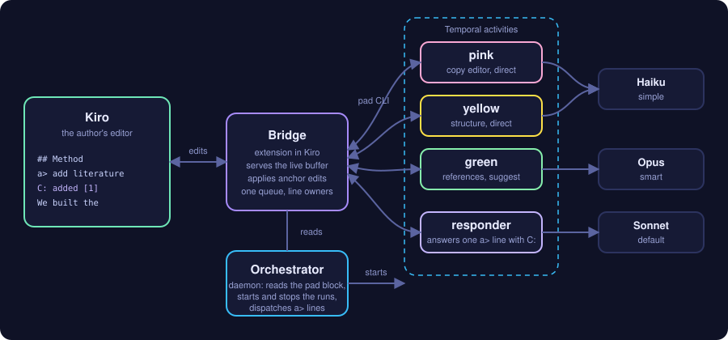

I built pad to co-edit a document with several AI agents inside the file I have open in Kiro. The agents read the editor buffer and write into it by anchor, so their edits land in the text while I keep typing, without a save step and without conflicts on line numbers. In the recording below, a copy editor, a structure editor and a reference checker work on a short paper while I write it. The session took about three and a half minutes.

I built it because switching between agent windows was costing me the thread. Interruptions make people finish faster but more stressed ([Mark et al., CHI 2008](https://doi.org/10.1145/1357054.1357072)), and switching tasks leaves an [attention residue](https://doi.org/10.1016/j.obhdp.2009.04.002) on the next one. Both papers describe my afternoons with Claude Code quite accurately.

## The problem with today's agent workflow

With Claude Code and similar tools, each agent has its own terminal or chat window. If I run a few of them in parallel I end up polling windows and rereading each history to remember what that agent was doing. The agents are fast, but I lose the time they saved on reloading what each one did.



*What I expect to happen, not what I measured.*

The picture I had in mind was HedgeDoc, the collaborative editor we use for notes at IETF meetings. Everyone writes in the same document and sees the others' text appear, with no inbox and no turn-taking. I wanted the agents to join a document that way, as extra writers, in the editor I already use.

## What it looks like

I write in a plain text buffer in [Kiro](https://kiro.dev/), a VS Code fork, and I never leave it to talk to an agent. A command to an agent is a line that starts with `a>`. A note for everyone, agents included, is a line that starts with `J:` (J for Jaime). Everything else is content. The agents are declared in a fenced block at the top of the document. This is the block from the demo, as I typed it:

````
```pad
pad:
  settle: 6
pink:
  role: copy editor, academic register, fix spelling and grammar directly
  tags: [simple, direct]
yellow:
  role: keep the IEEE paper skeleton (Abstract, Introduction, Related Work, Method, Evaluation, Conclusion); add missing section headings and move misplaced paragraphs under the right heading
  tags: [simple, direct]
green:
  role: references; for every sentence followed by (ref?) find one real, verifiable source (zot find, web2md) and propose the sentence with an IEEE-style citation using "green: =>"; never invent a source
  tags: [smart, suggest]
```
````

Each colour becomes an agent and the colour is its name. `simple` and `smart` pick the model (Haiku and Opus here, Sonnet when neither is given). `direct` lets an agent edit the content; `suggest` only lets it propose. `settle` is how long the text has to be still, in seconds, before a standing agent wakes up and reads what changed. The default is thirty; I set six for the recording so that things would happen on camera, which also means more wake-ups and a higher bill, since the bill is the number of times an agent wakes up and reads the document.

An `a>` line is handled differently. A daemon notices it, starts a one-shot agent on Sonnet, and that agent answers with a `C:` line under the command and does the work in the content. The colour agents comment under their own name, `pink:` and so on. This is the exchange from the demo, as it stands in the buffer, typo included:

```
AI agents cause too much context switching, normally this also causes
attention to become sparse. Human thought usually follows a thread. The
literature shows [1]
green: => The literature shows that interruptions make people work faster
  but under more stress [1], and that switching tasks leaves attention
  residue that lowers performance on the next task [2]. (Crossref-checked:
  the DOI of [1] is right, add pp. 107-110; [2] S. Leroy, ...)
a> add litarature
C: Added citation [1] (Mark et al., CHI 2008, on the cost of interrupted
   work) to your sentence and the entry under References; written from
   memory, not looked up this session, so check the DOI.
```

The responder added the citation and said it had not checked it. Green, whose job is references, then did check it: the DOI was right and the page numbers were missing, and it proposed the corrected sentence as a `green: =>` line for me to accept from the editor's lightbulb menu. I had not accepted it yet when the recording ends.

The thing that made the biggest difference to staying in the text is the thinking dots. When an agent picks up a command, dots appear under the line until the reply lands, because a silent wait is exactly what sends me to another window. Each agent's new text is highlighted in its colour for twelve seconds, which is how I see who did what. When the paper is done, `pad strip --all` removes every command, note, reply and the block itself, and leaves the content. Proposals I have not accepted or dismissed stay until I deal with them.

<video controls playsinline preload="metadata" width="100%" poster="/assets/images/2026-11-10-pad-demo-poster.webp">
  <source src="/assets/videos/pad-demo.mp4" type="video/mp4">
  Your browser does not support the video tag.
</video>

*The recording, played at 1.2x. It starts with the abstract already in place and ends on the LaTeX skeleton with a few commands still pending, so the cleanup step is not on camera.*

## How it works



The bridge is an extension inside Kiro that listens on localhost. It serves the live buffer, including what I have typed and not yet saved, and it applies the agents' edits as editor transactions, so my cursor and selection are remapped the same way they are when a colleague types above me in a shared document. The agents talk to it through a small `pad` CLI: `pad read`, `pad insert --after 'anchor'`, `pad replace`, `pad watch`.

The agents only get anchor operations. An edit names a substring of a line, and the bridge resolves it against the buffer at the moment it applies, not at the moment the agent read the file. Edits from all agents go through one queue. The bridge also tracks who wrote each line: a suggest agent may only add lines under its own name and edit those; a direct agent may edit content but not my commands and notes, not another agent's lines, and not the block. An edit within two lines of my cursor while I am typing waits until I pause. That combination, more than the anchors themselves, is what keeps three agents and me from clobbering each other. When an anchor is gone by the time the edit arrives, the agent gets an error and reads again.

Each agent is a language-model process with a role, a model and a mode taken from its entry in the block. A standing role loops: wait for the content to change and settle, read it, act on what is new, repeat. My keystrokes never reach a model, and an agent blocked waiting costs nothing.

## Models and runs

The model of each agent comes from the tags in the block and can change while the document is open. If the copy editor is doing fine on Haiku and the reference agent is not, I change its tag in the same buffer and the daemon restarts that agent on its next tick with the new model. The role text is the agent's prompt, so editing the role does the same. It turns out that the daemon does not wait for me to finish typing the line: while I rewrote yellow's role during the demo it stopped and restarted that agent every three seconds, more than a dozen times. It needs a debounce, and for now I write the new role elsewhere and paste it in one go.

A daemon watches the block and runs each agent as a [Temporal](https://temporal.io/) activity. I moved to Temporal because background processes of an editor session are invisible: when one hangs, I only find out by noticing that nothing happened. Temporal keeps an event history per run, with its id, status, input and result. I can list which agents are running and which failed, cancel one, restart one from the block, and read a finished agent's report after the session that started it is gone. Adding an entry to the block starts a run, removing it cancels the run.
